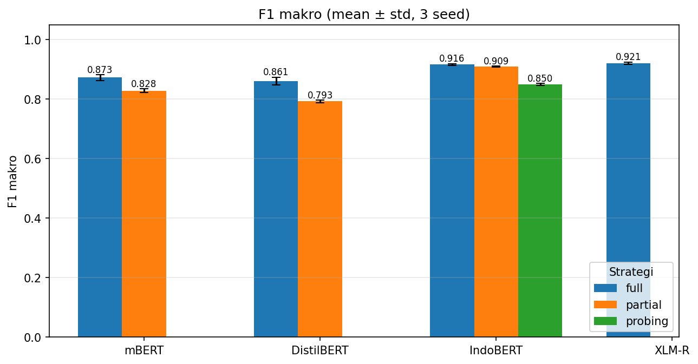
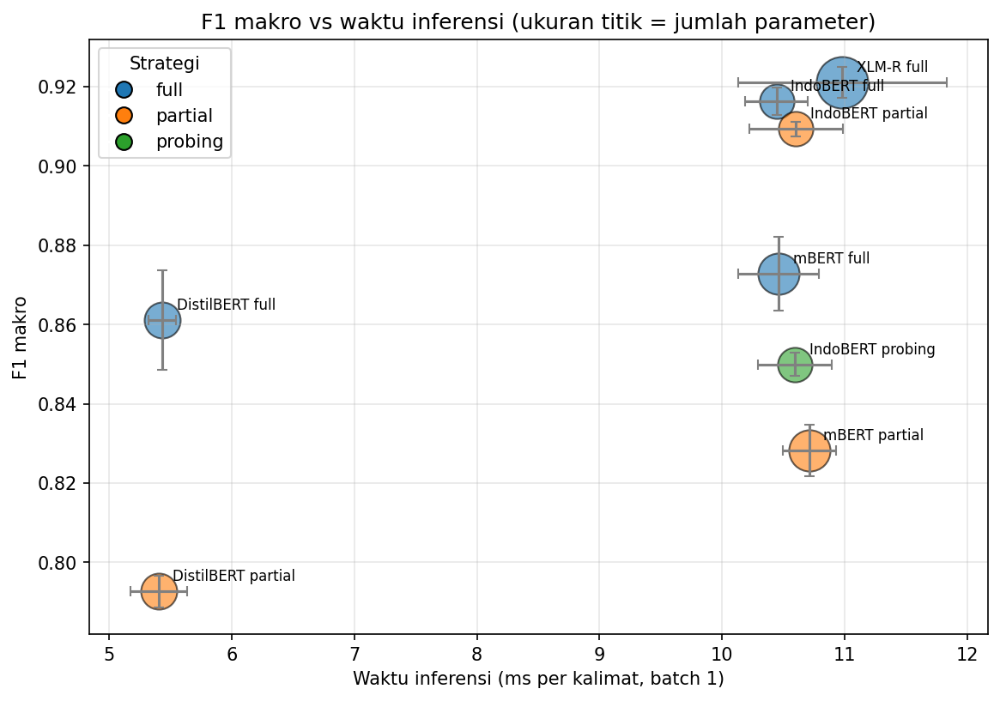

# Indo Sentiment Fine-tuning Benchmark

Proyek ini membandingkan beberapa model Transformer pretrained dan strategi fine-tuning
untuk klasifikasi sentimen Bahasa Indonesia (negatif, netral, positif). Fokusnya adalah
melihat seberapa besar pengaruh pilihan model dan jumlah parameter yang dilatih terhadap
performa dan efisiensi.

## Fokus

- **Model:** IndoBERT, mBERT, DistilBERT multilingual, dan XLM-R.
- **Strategi fine-tuning:** full fine-tuning, partial freezing (embedding + separuh layer awal dibekukan),
  dan linear probing (hanya head yang dilatih).
- **Evaluasi:** F1 makro, akurasi, F1 per kelas, waktu latih, waktu inferensi, jumlah parameter, dan memori GPU.
  Setiap konfigurasi dijalankan dengan 3 seed (42, 123, 2024), sehingga totalnya 24 run.

## Dataset

[SmSA](https://github.com/IndoNLP/indonlu/tree/master/dataset/smsa_doc-sentiment-prosa)
dari benchmark IndoNLU (Wilie dkk., 2020). Dataset diunduh otomatis oleh notebook.
Setelah pembersihan (duplikat, label bertentangan, dan kebocoran validasi), data latih berisi
10.933 kalimat dan data validasi 1.246 kalimat. Label uji resmi disembunyikan, sehingga
validasi resmi dipakai sebagai held-out set tanpa early stopping.

## Hasil

Rata-rata ± simpangan baku dari 3 seed, diukur di Kaggle (Tesla T4) dalam satu sesi.

| Backbone | Strategi | F1 makro | Akurasi | F1 netral | Latih (s) | Inferensi (ms/kalimat) | Param. dilatih | Memori puncak (MB) |
|---|---|---|---|---|---|---|---|---|
| mBERT | full | 0,8728 ± 0,0094 | 0,9085 ± 0,0064 | 0,7953 ± 0,0182 | 194,3 | 10,46 | 177,9 jt | 3.899 |
| mBERT | partial | 0,8282 ± 0,0065 | 0,8692 ± 0,0040 | 0,7475 ± 0,0121 | 115,3 | 10,71 | 43,1 jt | 1.968 |
| DistilBERT | full | 0,8612 ± 0,0126 | 0,9002 ± 0,0065 | 0,7764 ± 0,0266 | 105,4 | 5,44 | 135,3 jt | 2.499 |
| DistilBERT | partial | 0,7927 ± 0,0040 | 0,8454 ± 0,0023 | 0,6814 ± 0,0094 | 56,8 | 5,41 | 21,9 jt | 1.190 |
| IndoBERT | full | 0,9163 ± 0,0034 | 0,9401 ± 0,0020 | 0,8617 ± 0,0061 | 149,0 | 10,44 | 124,4 jt | 3.253 |
| IndoBERT | partial | 0,9093 ± 0,0019 | 0,9361 ± 0,0017 | 0,8495 ± 0,0024 | 92,6 | 10,60 | 43,1 jt | 1.745 |
| IndoBERT | probing | 0,8500 ± 0,0028 | 0,8890 ± 0,0017 | 0,7697 ± 0,0090 | 48,2 | 10,59 | 2.307 | 584 |
| XLM-R | full | **0,9211 ± 0,0040** | **0,9428 ± 0,0030** | **0,8732 ± 0,0166** | 205,6 | 10,98 | 278,0 jt | 5.008 |





### Temuan utama

- **Backbone lebih berpengaruh daripada strategi.** IndoBERT unggul jelas atas mBERT dan DistilBERT, dan bahkan
  IndoBERT partial (0,9093) masih mengungguli mBERT full (0,8728).
- **XLM-R full memberi F1 tertinggi** (0,9211), tetapi hanya sedikit di atas IndoBERT full (0,9163), dengan
  parameter 2,2x, waktu latih 1,4x, dan memori 1,5x lebih besar.
- **Partial freezing pada IndoBERT hampir gratis:** F1 hanya turun 0,0070, sedangkan waktu latih 1,6x lebih cepat
  dan memori 46% lebih kecil. Pada mBERT dan DistilBERT, penurunannya jauh lebih besar.
- **Freezing menghemat biaya latih, bukan inferensi.** Waktu inferensi ketiga strategi hampir sama, karena arsitektur
  saat prediksi tidak berubah.
- **DistilBERT inferensi 1,9x lebih cepat** daripada mBERT dengan F1 98,7% (full). Namun parameternya hanya berkurang
  24%, karena tabel embedding multibahasa tetap utuh.
- **Kelas netral (10% data) selalu menjadi kelas tersulit** di semua konfigurasi.

Rekomendasi: **IndoBERT full** sebagai kompromi terbaik antara akurasi dan biaya, atau **IndoBERT partial** bila
sumber daya latih terbatas. Analisis lengkap, uji selisih antar-konfigurasi, dan kesimpulan per hipotesis
ada di notebook.

## Struktur

```
indo-sentiment-finetuning-benchmark/
├── docs/
│   └── rancangan_eksperimen.md          # hipotesis, variabel terkendali, matriks 24 run
├── notebooks/
│   └── finetuning_benchmark_smsa.ipynb  # notebook eksperimen lengkap beserta output (mode penuh)
├── results/
│   ├── figures/
│   │   ├── confusion_matrix_terbaik.png # confusion matrix konfigurasi terbaik (3 seed)
│   │   ├── eda_smsa.png                 # distribusi label dan panjang kalimat
│   │   ├── f1_macro.png                 # F1 makro per backbone x strategi
│   │   ├── f1_vs_inferensi.png          # trade-off F1 vs waktu inferensi
│   │   └── waktu_latih.png              # waktu latih per backbone x strategi
│   ├── hasil_smsa_29c39f81.csv          # hasil setiap run (24 baris)
│   ├── rekap_agregat_smsa_29c39f81.csv  # rata-rata ± std per backbone x strategi
│   └── uji_selisih_smsa_29c39f81.csv    # uji selisih bermakna antar-konfigurasi
├── .gitignore
├── README.md
└── requirements.txt
```

## Cara menjalankan

**Kaggle (cara yang dipakai untuk hasil di atas):**
1. Import `notebooks/finetuning_benchmark_smsa.ipynb` ke Kaggle Notebook.
2. Settings: Accelerator **GPU T4**, Internet **On**.
3. Di sel Konfigurasi, atur `MODE = "penuh"`, lalu **Save Version → Save & Run All**. Durasinya sekitar 50 menit.
4. Hasil CSV dan grafik tersimpan di tab **Output** versi tersebut.

**Lokal:**
```bash
pip install -r requirements.txt
jupyter lab notebooks/finetuning_benchmark_smsa.ipynb
```
Gunakan `MODE = "uji"` untuk pengecekan cepat (500 data, 1 epoch, 1 seed). Mode penuh membutuhkan GPU
dengan VRAM sekitar 8 GB atau lebih, karena XLM-R full dengan batch 32 memakai sekitar 5 GB.

Notebook menulis hasil per run ke CSV dan dapat melanjutkan run yang terputus secara otomatis.

## Keterbatasan

- Evaluasi memakai validasi resmi karena label uji SmSA disembunyikan.
- Hyperparameter sama untuk semua backbone dan tidak dituning per model.
- Selisih dinilai dengan aturan "selisih rata-rata > simpangan baku antar-seed", bukan uji statistik formal,
  dan hanya dengan 3 seed.
- Waktu dan memori diukur pada satu jenis GPU (Tesla T4, fp16).
- Hanya satu dataset.
